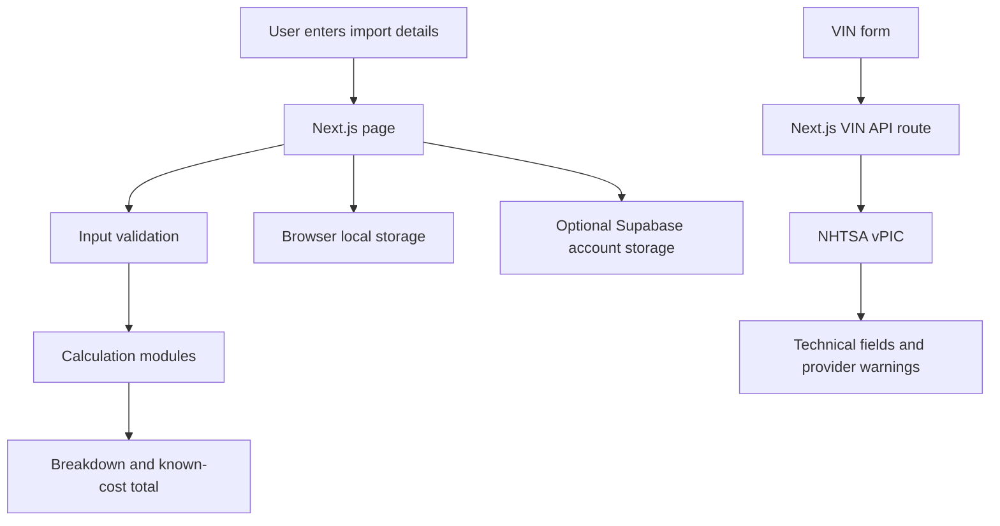

# Portavero

[](https://github.com/GIORGIO2032Q4E/portavero/actions/workflows/ci.yml)

Portavero is a student-built project for planning the cost of bringing a vehicle or other goods into Georgia. It started with a practical question about auction-car imports: the bid is only one part of the price. Buyer fees, transport to the export port, sea freight, customs and delivery all come later.

The project brings those figures into one place. It also includes a limited vehicle-tax estimator, a VIN technical-data lookup and a small vehicle comparison tool. It is a working prototype, not a customs service or a source of live market prices.

- **Live site:** https://portavero.vercel.app
- **Source code:** https://github.com/GIORGIO2032Q4E/portavero
- **Main stack:** Next.js App Router, React, TypeScript, JavaScript modules and CSS
- **Node.js:** 24

## What the current version does

| Part | What it does | What it does not do |
| --- | --- | --- |
| General import calculator | Adds entered costs in USD, EUR, GBP, GEL or JPY. It can estimate duty and VAT/GST when the user enters the rates. It shows missing cost categories. | It does not choose a tariff code, retrieve a legal rate, convert currencies using a live rate or determine the destination country's tax base. |
| Vehicle import planner | Uses vehicle details and a limited set of rules to estimate selected excise and import-duty amounts for passenger vehicles. It adds GEL 480 in listed standard fees and accepts other costs entered by the user. | It is not an official assessment. It does not cover every vehicle classification, exception or transitional case. The fee amount and rules must be checked before use. |
| Vehicle catalogue | Provides a curated starter list of makes, models and engine variants. | It is not a complete database. Engine specifications vary by model year and market. Where a variant covers more than one engine size, the planner asks for the exact capacity rather than selecting one on the user's behalf. |
| VIN check | Sends a VIN from the server route to the U.S. National Highway Traffic Safety Administration's vPIC decoder and displays available technical fields. | It does not search accident, title, ownership, odometer, service or auction records. It does not return original auction photos. |
| Vehicle comparison | Stores up to four candidates in the current browser and compares entered specifications, costs and notes. | The list does not sync to an account or another device. VINs are recorded for reference and are not decoded by the comparison page. User notes are not verified. |
| Shipping quote comparison | Compares up to three offers entered on the shipping page. It groups price comparisons by currency and shows provider-entered transit days and insurance status. | It does not contact carriers, fetch live quotes, verify offers or save the comparison after leaving the page. |
| Saved estimates | Keeps up to ten general calculator estimates in browser storage. With Supabase configured, a signed-in user can save a copy to their account, list it, load it into the browser calculator and delete it. | Local edits to an already saved estimate do not update the existing cloud record automatically. Cloud storage needs a working Supabase project and the database setup below. |
| Print / PDF | Uses the browser print dialog to print an estimate or save it as a PDF. | Output can vary by browser and printer settings. It should be checked before relying on it as a formal document. |

The feature descriptions above refer to the code in this repository. A blank cost field is not treated as a confirmed zero. A displayed total is only as complete as the values and rules used to calculate it.

## How the code is organised

The project uses the Next.js App Router. Page components handle the forms and presentation; calculation and validation rules live in separate modules so they can be tested without rendering the website.

```text
src/
  app/
    api/vin-check/       Server route that calls NHTSA vPIC
    calculator/          General import calculator
    vehicle-import/      Vehicle cost and tax estimate
    vin-check/            VIN input and technical-data display
    vehicles/             Curated vehicle catalogue
    compare/              Browser-based vehicle comparison
    shipping/              Checklist and manual quote comparison
    account/               Optional Supabase account interface
    about/                 Project purpose and scope
    how-it-works/          Calculation explanations
  components/
    NumberField.tsx        Shared numeric input and validation UI
    SiteHeader.tsx         Site navigation
  data/
    vehicle-catalog.ts     Curated vehicle and engine variants
  lib/
    import-costs.mjs       General import arithmetic
    vehicle-import-costs.mjs
    vehicle-tax.mjs       Vehicle-tax rules currently encoded in the app
    vehicle-selection.mjs Manual powertrain-selection state
    number-input.mjs      Numeric input validation
    vin.mjs               VIN format and NHTSA warning handling
    saved-vehicles.mjs    Validation of browser-saved comparison data
    auth.ts               Supabase Auth and saved-estimate requests
supabase/
  schema.sql              Saved-estimate table, constraints and RLS policies
.github/
  workflows/ci.yml        Repository validation on pushes and pull requests
```

A simplified request and calculation flow looks like this:



The general import calculator and vehicle planner do not call a customs API. Their results are produced from entered values and the rules included in the source code. The VIN route is different: it makes a server-side request to NHTSA vPIC, with a request timeout, and returns the fields that source supplies.

## Implementation decisions

A few choices in the code are deliberate trade-offs rather than claims that the prototype solves every part of importing:

- **Keep calculation rules separate from the interface.** The import-cost, vehicle-tax, number-input and saved-data modules can be tested with Node without mounting a React page. This also keeps page components focused on collecting inputs and showing results.
- **Validate before calculating.** Blank values remain different from confirmed zero values. Negative, malformed and unsafe values are rejected so an invalid amount does not silently become part of a total.
- **Send VIN requests through a server route.** The route validates the VIN shape, calls NHTSA vPIC with a timeout and returns selected fields plus provider warnings. It keeps the external request in one place and makes the source of the returned data visible.
- **Use local storage for small personal working lists.** General estimates and vehicle candidates stay in the current browser, with fixed limits. Supabase is optional for general saved estimates rather than being required just to use the calculators.
- **Do not imply live information that is not connected.** Freight prices, exchange rates and customs rates are either entered by the user or checked against linked official sources. The site labels the result as a planning estimate instead of presenting it as a quote or ruling.
- **Keep legal calculations conservative.** The vehicle-tax module is limited to selected passenger-vehicle cases. When the catalogue does not know a single engine displacement, the form asks for the capacity rather than choosing one arbitrarily.

These choices keep the current build understandable, but they also leave work to do. The CI pipeline now starts the compiled production server and checks the main routes, metadata endpoints, baseline HTTP security headers and local rejection of invalid VINs. This is a server smoke test, not a browser interaction test. The browser-stored Supabase session should be revisited before the account feature is used for sensitive data, and the key user journeys still need manual or browser-level testing.

## Calculation notes and source material

### General import calculator

The general calculator sums nine cost categories. The duty estimate uses the user's entered duty percentage and the calculator's customs-value inputs. VAT/GST is estimated from the entered customs-value costs, calculated import duty and the user-entered excise/other-tax field. These are arithmetic choices in the application, not a claim that every country's legal tax base uses those components.

The correct tariff code, rate, country of origin, exemptions and tax base must be checked with the destination customs authority. The project includes links to official tariff resources for several common destinations, but it does not retrieve a rate from them.

### Vehicle import planner

The planner is intended for selected passenger vehicles classified under HS 8703. The current rules in `src/lib/vehicle-tax.mjs` include:

- Age-based excise rates and selected hybrid and right-hand-drive adjustments.
- A limited electric-vehicle treatment.
- A classic-car rate for vehicles meeting the age and legal-classification conditions.
- An import-duty calculation based on engine capacity and vehicle age.
- A manually selectable previous regime for qualifying transitional cases. Selecting it does not prove eligibility.

The main legal reference is the [Tax Code of Georgia](https://matsne.gov.ge/en/document/view/1043717), particularly Articles 188, 197 and 199. The April 2026 change and its transition conditions should also be read with the [Revenue Service notice](https://voice.rs.ge/Default.aspx?id=3874).

The GEL 480 amount is the sum of the seven standard charges currently listed on the [Revenue Service Auto/Moto Levy Calculator](https://www.rs.ge/CarClearance-en): clearance, customs declaration, expert examination, internal transit number, registration certificate, registration plate and inspection act. The fee schedule can change. The amount in the code is a snapshot, not a live lookup.

**Source review date: 8 November 2026.** Tax law, fee schedules and eligibility rules can change. The code and tests describe the application's current implementation, not an official interpretation. Check the current Revenue Service calculator and seek clarification from the Revenue Service or a qualified customs broker before buying or shipping a vehicle. Do not use a catalogue variant as proof of the engine fitted to a particular car.

### VIN decoder

The VIN route calls the [NHTSA vPIC API](https://vpic.nhtsa.dot.gov/api/) and uses the `DecodeVinValuesExtended` endpoint. The information is manufacturer-submitted technical data. Availability can vary, especially for vehicles made for markets outside the United States. The application checks VIN shape first, but a valid-looking 17-character string is not proof that a vehicle exists or that the returned data matches the physical car.

NHTSA vPIC is not a vehicle-history service. No accident, title, mileage, ownership, service or auction-history search is performed.

## Data storage and privacy

The current prototype uses different storage methods for different features:

- General calculator estimates are stored in the browser's local storage, up to ten entries.
- Vehicle comparison candidates, including any VIN and notes entered by the user, are stored in the browser's local storage, up to four entries.
- Shipping quote comparisons remain in the current page state and are not saved.
- VINs submitted through the VIN checker are sent to the Portavero API route and then to NHTSA vPIC for decoding.
- If Supabase is configured, account authentication and saved general estimates use the Supabase project. The SQL setup enables row-level security so a signed-in user can access only rows belonging to that account.
- The current authentication implementation stores the Supabase session in browser local storage. It does not use an HttpOnly session cookie. This is a known security limitation of the prototype; avoid signing in on shared or untrusted devices.

Do not enter passwords, payment details, identity documents or other sensitive information into estimate names or notes. The privacy page on the site gives more detail about the prototype's data handling and third-party services.

## Run locally

### Requirements

- Node.js 24
- npm
- Git

Clone the repository and install the locked dependencies:

```bash
git clone https://github.com/GIORGIO2032Q4E/portavero.git
cd portavero
npm ci
```

Create `.env.local` from `.env.example`. The site can run without Supabase credentials; account sign-up, sign-in, password recovery and cloud estimate storage will be unavailable until Supabase is configured.

On macOS or Linux:

```bash
cp .env.example .env.local
```

On Windows PowerShell:

```powershell
Copy-Item .env.example .env.local
```

Start the development server:

```bash
npm run dev
```

Open http://localhost:3000.

### Environment variables

| Variable | Required for | Notes |
| --- | --- | --- |
| `NEXT_PUBLIC_SITE_URL` | Correct metadata and sitemap URL | Use `http://localhost:3000` locally and the production domain when deploying. |
| `NEXT_PUBLIC_SUPABASE_URL` | Optional accounts and cloud estimates | The Supabase project URL. |
| `NEXT_PUBLIC_SUPABASE_PUBLISHABLE_KEY` | Optional accounts and cloud estimates | Use the project's public publishable key. |
| `NEXT_PUBLIC_SUPABASE_ANON_KEY` | Legacy alternative | Supported for projects that still use the anon key name. |

Only public Supabase keys belong in `NEXT_PUBLIC_*` variables. Never put a service-role key or other secret in browser-accessible variables, source files or Git history. Do not commit `.env.local`.

### Supabase setup

1. Create a Supabase project.
2. Add the project URL and public publishable key to `.env.local` and the Vercel environment variables.
3. Run `supabase/schema.sql` in the Supabase SQL Editor.
4. Set the Supabase Auth site URL and allowed redirect URLs for local development and the production site.
5. Confirm that the saved-estimates table has row-level security enabled and that the policies in the SQL file are active.

The application uses Supabase Auth and the REST API directly. It does not use the Supabase client SDK. The SQL file creates the `saved_estimates` table and applies ownership policies to select, insert, update and delete operations.

## Tests and checks

Run the same main checks used by GitHub Actions:

```bash
npm ci
npm audit --audit-level=moderate
npm run lint
npm run typecheck
npm test
npm run build
```

The test suite uses Node's built-in test runner. It covers:

- Vehicle-tax rate boundaries, vehicle age, hybrid, steering, electric and classic-car cases.
- General import arithmetic, missing values, user-entered rates, currency precision and unsafe totals.
- Vehicle-import cost totals, invalid expenses and fee inclusion.
- VIN format validation and the conversion of NHTSA warning codes into messages.
- Numeric field parsing, decimal precision and maximum values.
- Validation and limits for browser-saved vehicle comparison data.
- Manual vehicle-type selection state, including clearing a previous catalogue engine selection.

GitHub Actions runs the dependency audit, lint, TypeScript check, unit tests and production build on pushes to `main` and pull requests targeting `main`. The build uses a placeholder site URL because the production URL is not needed to compile the app.

**What the automated checks do not cover:** there is no browser end-to-end test suite at present. CI does not make live calls to NHTSA or Supabase and does not verify real account email delivery, tax determinations, responsive layouts in every browser or the print dialog on every platform. Use the [manual QA checklist](docs/MANUAL_QA.md) for those checks. A checklist item is not evidence that it has been completed; record the date and result when running it. The latest completed live checks are recorded in [the 9 November 2026 production QA record](docs/RELEASE_QA_2026-11-09.md).

## License

There is currently no license file in this repository. The source is publicly viewable, but that alone does not grant permission to reuse or redistribute it. Add an explicit license only after deciding how the project should be shared.

## Deployment

The repository is connected to Vercel. Pull requests receive preview deployments. Merges to `main` trigger a production deployment at https://portavero.vercel.app.

The deployment requires the same public environment variables described above. Supabase account features remain unavailable unless the Supabase project, SQL schema and redirect URLs are configured.

## Known limitations and next work

The main areas that still need attention are:

1. Verify the vehicle catalogue against exact model years, markets and engine codes. The planner now asks for a manual capacity when a catalogue entry covers multiple displacements.
2. Review the vehicle-tax rules and standard-fee snapshot whenever the Tax Code or Revenue Service fee schedule changes.
3. Add browser-level tests for the key calculator, comparison, VIN and account journeys.
4. Revisit authentication session storage before treating the account feature as suitable for sensitive data or commercial use.
5. Verify print output and mobile layouts in real browsers and keep a dated QA record.

The project is intentionally kept small. The priority is to make the calculations, boundaries and limitations clear before adding more services or integrations.
